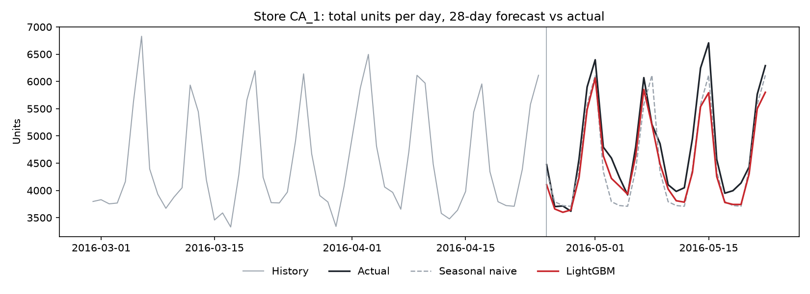
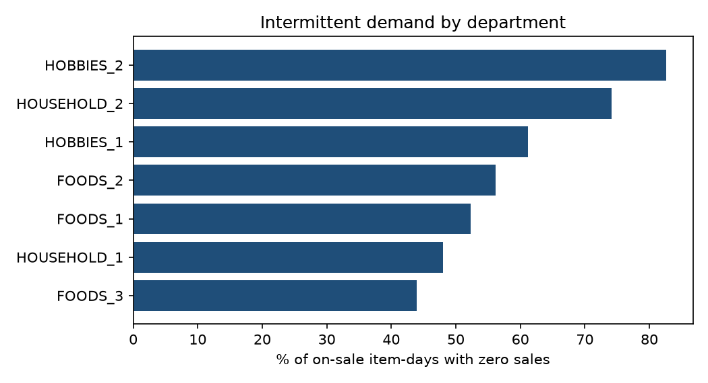
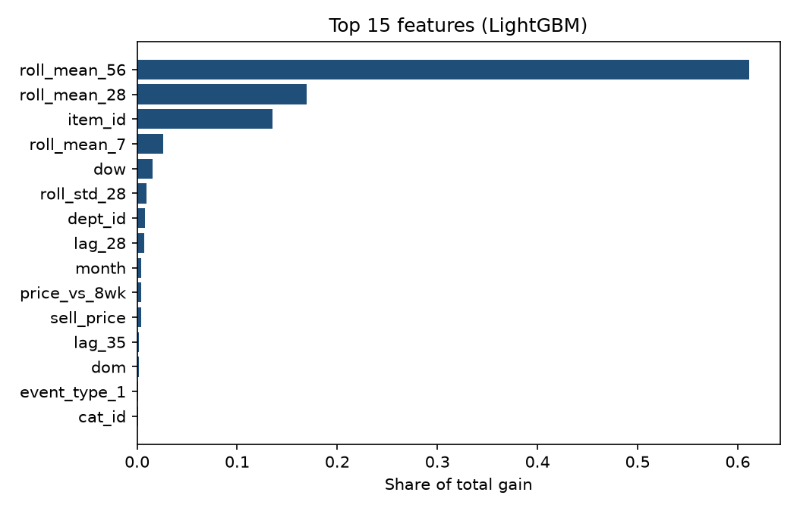

# Retail Demand Forecasting with LightGBM (Walmart M5, store CA_1)

Forecasting daily unit sales of ~3,000 products 28 days ahead, after auditing the data with SQL.

<!-- TODO after running train.py: replace the line below with your own one-sentence result -->
**Result:** LightGBM lowers WAPE by __% compared with the best simple baseline on a 28-day hold-out.



## Results

<!-- TODO: paste the table from reports/metrics.md here -->

| Model | WAPE | RMSE | MAE | Bias |
| --- | --- | --- | --- | --- |
| Last-28-day mean (baseline) | | | | |
| Seasonal naive: same weekday last week (baseline) | | | | |
| **LightGBM (Tweedie)** | | | | |

WAPE = total absolute error / total units sold (lower is better).
Per-department results: [`reports/wape_by_dept.csv`](reports/wape_by_dept.csv).

## Data quality findings

Checks are written in SQL ([`sql/data_quality_checks.sql`](sql/data_quality_checks.sql)) and run with DuckDB.
Full report: [`reports/data_quality.md`](reports/data_quality.md).

<!-- TODO: write 3-5 findings from reports/data_quality.md, each with a number and what you did about it -->
- **Items not on sale:** __% of item-days have no price, and sales on those days are always 0 → excluded from training and forecast as 0.
- **Store closures:** __ days with almost no sales (e.g. 25 December) → kept, the model learns them from the calendar.
- **Intermittent demand:** __% of on-sale item-days sell nothing (highest in ____) → Tweedie loss instead of plain squared error.
- **Spikes:** __ item-days sell more than 10x the item's average → checked by hand, kept as real demand.



## Approach

1. **Data** – M5 *sales_train_evaluation*, calendar and weekly prices for one store from 2014-01-01, reshaped to one row per item per day (`src/prepare_data.py`).
2. **Validation** – split by time: train → 28-day validation window (early stopping) → final 28-day test window. No random splits.
3. **Features** (`src/features.py`) – sales lags of 28–56 days and rolling means/std ending 28 days back (no information from inside the forecast window), price vs its 8-week average, weekly price change, day of week/month, events and SNAP days, item/department/category.
4. **Model** – LightGBM with a Tweedie objective, refit on train + validation before forecasting the test window (`src/train.py`).
5. **Baselines** – last-28-day mean and seasonal naive (same weekday last week).



## How to run

```bash
python -m venv .venv
# Windows: .venv\Scripts\activate    macOS/Linux: source .venv/bin/activate
pip install -r requirements.txt
# Download the M5 data from Kaggle (see below) into data/raw/
python src/prepare_data.py
python src/data_quality.py
python src/train.py
```

## Project structure

```
├── data/raw/                  # Kaggle files (not in the repo)
├── reports/                   # data quality report, metrics, figures
├── sql/data_quality_checks.sql
└── src/
    ├── config.py              # store, start date, horizon
    ├── prepare_data.py        # step 1: tidy table
    ├── data_quality.py        # step 2: SQL checks + report
    ├── features.py            # feature engineering
    └── train.py               # step 3: baselines, LightGBM, evaluation
```

## Next steps

<!-- TODO: keep the ones you find most interesting -->
- Rolling-origin backtest over several 28-day windows instead of one.
- Train one model per department and compare.
- Add SHAP explanations for individual forecasts.

## Data

[M5 Forecasting – Accuracy](https://www.kaggle.com/competitions/m5-forecasting-accuracy) (Kaggle, Walmart unit sales 2011–2016).
The data is not included in this repository: accept the competition rules on Kaggle, download the files and put
`calendar.csv`, `sell_prices.csv` and `sales_train_evaluation.csv` in `data/raw/`.
