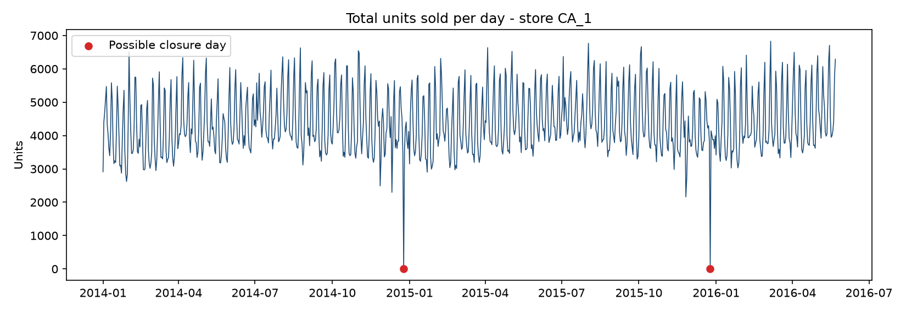
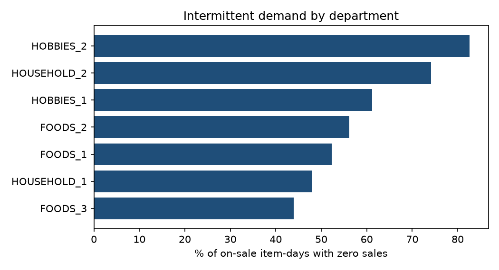

# Data quality report - Walmart store CA_1

Generated by `src/data_quality.py` from the checks in `sql/data_quality_checks.sql`.

## 1. Table size

How many items, days and rows the table holds, and the period it covers.

| items | days | item_days | first_day | last_day |
| --- | --- | --- | --- | --- |
| 3049 | 873 | 2661777 | 2014-01-01 00:00:00 | 2016-05-22 00:00:00 |

## 2. Missing dates

Every calendar day between the first and the last date should be present.

| expected_days | actual_days |
| --- | --- |
| 873 | 873 |

## 3. Duplicate rows

Each item should have exactly one row per day.

| duplicated_item_days |
| --- |
| 0 |

## 4. Invalid values

Sales cannot be negative and prices must be positive.

| negative_sales | non_positive_prices |
| --- | --- |
| 0 | 0 |

## 5. ID consistency

item_id should start with its dept_id, and dept_id should start with its cat_id.

| items_with_mismatched_ids |
| --- |
| 0 |

## 6. Missing prices

A missing price means the item was not on sale that week, so its sales should be zero.

| item_days_without_price | pct_of_all_item_days | units_sold_without_price |
| --- | --- | --- |
| 75674 | 2.84 | 0 |

## 7. Items launched during the period

Items whose first price appears after the first day were not yet on the shelf before that.

| items_launched_later | items_never_on_sale | all_items |
| --- | --- | --- |
| 419 | 0 | 3049 |

## 8. Zero-sales days by category

Share of item-days with zero sales while the item was on sale (intermittent demand).

| cat_id | on_sale_item_days | pct_zero_sales |
| --- | --- | --- |
| HOBBIES | 484005 | 66.7 |
| HOUSEHOLD | 887148 | 60.9 |
| FOODS | 1214950 | 48.6 |

## 9. Possible store closure days

Days when total store sales fall below 10% of the median day.

| day | total_units | share_of_median_day |
| --- | --- | --- |
| 2014-12-25 00:00:00 | 0 | 0.0 |
| 2015-12-25 00:00:00 | 0 | 0.0 |

## 10. Extreme spikes (count)

On-sale item-days selling at least 10 units and more than 10 times the item's average.

| spike_item_days | items_with_spikes |
| --- | --- |
| 1160 | 410 |

## 11. Extreme spikes (top 15)

The largest spikes, to inspect by hand: real demand (events, promotions) or data errors?

| id | day | sales | item_avg | times_avg | event_name_1 |
| --- | --- | --- | --- | --- | --- |
| HOUSEHOLD_1_133_CA_1_evaluation | 2014-10-02 00:00:00 | 239 | 1.01 | 237.4 |  |
| HOBBIES_2_100_CA_1_evaluation | 2014-11-29 00:00:00 | 34 | 0.46 | 74.0 |  |
| FOODS_3_153_CA_1_evaluation | 2015-06-07 00:00:00 | 17 | 0.24 | 70.3 |  |
| HOBBIES_2_143_CA_1_evaluation | 2015-02-19 00:00:00 | 15 | 0.22 | 69.3 |  |
| FOODS_1_189_CA_1_evaluation | 2015-03-03 00:00:00 | 31 | 0.47 | 66.5 |  |
| FOODS_1_088_CA_1_evaluation | 2016-05-18 00:00:00 | 77 | 1.21 | 63.8 |  |
| HOBBIES_2_124_CA_1_evaluation | 2015-04-21 00:00:00 | 70 | 1.1 | 63.7 |  |
| HOBBIES_2_122_CA_1_evaluation | 2015-12-13 00:00:00 | 13 | 0.23 | 57.6 |  |
| FOODS_3_315_CA_1_evaluation | 2015-07-25 00:00:00 | 22 | 0.39 | 56.3 |  |
| HOBBIES_1_408_CA_1_evaluation | 2014-08-24 00:00:00 | 78 | 1.39 | 56.0 |  |
| FOODS_1_093_CA_1_evaluation | 2015-10-31 00:00:00 | 10 | 0.2 | 49.6 | Halloween |
| HOBBIES_1_066_CA_1_evaluation | 2015-11-06 00:00:00 | 25 | 0.51 | 49.3 |  |
| HOBBIES_1_145_CA_1_evaluation | 2016-05-13 00:00:00 | 24 | 0.49 | 48.5 |  |
| HOUSEHOLD_1_199_CA_1_evaluation | 2015-10-25 00:00:00 | 11 | 0.23 | 48.0 |  |
| HOBBIES_2_143_CA_1_evaluation | 2014-07-10 00:00:00 | 10 | 0.22 | 46.2 |  |

## 12. Price changes per item

How many different prices each item had; many changes suggest promotions.

| n_prices | items |
| --- | --- |
| 1 | 1541 |
| 2 | 1018 |
| 3 | 315 |
| 4 | 111 |
| 5 | 34 |
| 6 | 14 |
| 7 | 8 |
| 8 | 6 |
| 9 | 2 |

## Figures

